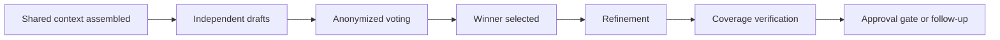

# LLM Council

> [!IMPORTANT]
> **TL;DR:** LoopTroop uses a structured multi-model council (draft → vote → refine → verify) for every planning decision. Models compete independently before converging, so blind spots from any single provider are caught before execution begins.

> [!TIP]
> **Why use a Council?** Think of it like a design agency. If you hire one designer, you get one idea. If you hire three designers, have them pitch ideas independently, and then vote on the best elements from each, the final product is vastly superior. That's exactly what the LLM Council does for your code.

LoopTroop uses a council whenever it is choosing a plan, not just executing one. The council is a structured draft, vote, refine pipeline that is reused across interview generation, PRD creation, and bead planning.

## 1. Where The Council Appears

| Domain | Draft phase | Vote phase | Refine phase | Coverage follow-up |
| --- | --- | --- | --- | --- |
| Interview | `COUNCIL_DELIBERATING` | `COUNCIL_VOTING_INTERVIEW` | `COMPILING_INTERVIEW` | `VERIFYING_INTERVIEW_COVERAGE` |
| PRD | `DRAFTING_PRD` | `COUNCIL_VOTING_PRD` | `REFINING_PRD` | `VERIFYING_PRD_COVERAGE` |
| Beads | `DRAFTING_BEADS` | `COUNCIL_VOTING_BEADS` | `REFINING_BEADS` | `VERIFYING_BEADS_COVERAGE` then `EXPANDING_BEADS` |

## 2. Council Lifecycle

The important detail is independence. Models do not co-author one shared draft during the draft stage.

## 3. Step 1: Independent Drafting

Each council member receives the same allowed context for the stage and produces its own artifact:

- interview question set
- PRD draft
- bead blueprint

This is where LoopTroop deliberately seeks diversity. A single draft tends to encode one model's blind spots. Multiple independent drafts surface alternative framing, edge cases, and decomposition strategies.

PRD drafting has an extra first part: each member first produces its own Full Answers artifact from the approved interview, filling skipped answers when needed. The member then drafts its PRD from that completed answer set. After voting and refinement, the winning model's Full Answers artifact is available read-only from the PRD approval screen as supporting context.

Full Answers, PRD and beads drafting, refinement, coverage, and bead expansion can use focused read-only repository inspection when their supplied artifacts do not provide concrete evidence for a repository-specific claim. They review `relevant_files` first and inspect only the smallest useful manifests, build definitions, task configuration, CI files, or source locations needed to confirm a command, path, framework, package manager, build system, or test runner. Full Answers use inspection only for technical facts needed to resolve skipped answers; all voting remains tool-disabled.

If a member's Full Answers artifact is invalid after the configured structured retries, that member's PRD draft is not started. LoopTroop records a concise skipped/invalid PRD draft diagnostic instead of copying the Full Answers malformed text into the PRD draft artifact. A member you stop during Part 1 does not start its PRD draft either. One you stop during Part 2 loses its Part 1 answers as well, so nothing it wrote reaches the vote or the refinement, and retrying it redoes both parts (see [Stopping Or Retrying One Model](#stopping-or-retrying-one-model)).

Rejected model responses are diagnostic data, not draft bodies. Accepted drafts persist normalized artifact content; invalid, failed, or timed-out outputs show only outcome, model, validation/retry diagnostics, and short excerpts in the structured artifact view. The full malformed responses remain available through Raw attempt views and execution logs. A member you stopped shows as Stopped, and nothing it wrote becomes a draft.

## 4. Step 2: Structured Voting

Voting evaluates anonymized drafts against a structured rubric.

LoopTroop reduces obvious bias by:

- removing authorship from the drafts
- randomizing presentation order
- recording per-model vote artifacts
- resolving the winner from structured scores and ranking output

Each vote uses five rubric categories. Every category is scored as an integer
from **0 to 20**, and `total_score` must be an integer from **0 to 100** that
exactly equals their sum.

The goal is not consensus chat. The goal is competitive evaluation under the same rubric.

Only drafts that actually received scores can win. When scored drafts tie, the
main implementer wins the tie outright; otherwise LoopTroop falls back to the
configured council order as the deterministic tie-breaker.

**One exception to "the drafts are identical in kind."** If a member stopped to ask you something and you answered, that member drafted against instructions the others never saw, and the voters have not seen them either. Left unmarked, the draft that actually followed your steering reads as the one that disagrees with everybody else, so the most informed draft is the one most likely to lose. Such a draft carries a note saying its author was given an answer during drafting and that it should not be marked down merely for differing. The note names no model, so anonymity holds.

## 5. Step 3: Refinement

Once a winner is selected, the winning direction is refined into the canonical artifact for the phase. This process is driven by the orchestration logic in `server/council/refiner.ts` and supported by utilities in `server/council/draftUtils.ts` to merge the strongest elements from competing drafts into the final output.

That refined artifact is what later phases see:

- the interview document feeds the Q&A loop
- the PRD feeds beads planning
- the beads plan feeds execution

## 6. Step 4: Coverage

The council does not end at "winner picked." LoopTroop then checks whether the artifact is complete enough to move on.

| Domain | Coverage action |
| --- | --- |
| Interview | Generate targeted follow-up questions when gaps remain |
| PRD | Revise the PRD until coverage is acceptable or the pass budget is exhausted |
| Beads | Revise the bead plan until coverage is clean or capped (`VERIFYING_BEADS_COVERAGE`), then expand into execution-ready beads in a separate `EXPANDING_BEADS` pass |

For interview coverage, **clean** means no unresolved gaps and no follow-up
questions. A `0%` follow-up budget means none are generated even if gaps remain;
those gaps stay visible and the ticket advances to approval.

This is why the council is better understood as a planning discipline than as a single phase.

## 7. Inputs And Outputs By Stage

| Domain | Main council inputs | Main output |
| --- | --- | --- |
| Interview | Ticket details, relevant files | Canonical interview document and question session |
| PRD | Ticket details, relevant files, approved interview, member-specific Full Answers | Approved PRD |
| Beads | Ticket details, relevant files, approved PRD | Expanded bead plan |

Each domain inherits only the artifacts it needs. See [Context Engineering](context-engineering.md) for the exact allowlists.

## 8. Quorum And Failure

The council is configured, not open-ended.

Important controls include:

- the chosen main implementer
- council member list
- per-project or profile quorum settings
- AI response timeout

> [!TIP]
> For the full reference including defaults, ranges, and practical guidance for all of these settings, see the [Configuration Reference](/configuration).

### Main Implementer

The main implementer is the primary model LoopTroop locks onto the ticket once work starts. It handles the early single-model groundwork, stays auto-included in the council, and remains the primary execution model during coding and final verification.

### Council Members

Council members are the additional models that participate in independent drafting and structured voting during interview, PRD, and beads planning. They increase planning diversity, but they do not replace the main implementer as the ticket's primary execution owner.

### Min Council Quorum

Minimum council quorum is the smallest number of valid council outputs LoopTroop requires before it trusts a draft or vote phase. If the configured quorum is not met, the workflow blocks or retries instead of silently accepting a weak result. A model you stop does not count toward it.

### AI Response Timeout

AI response timeout is the per-model wait budget for planning and review prompts that expect model output, including relevant-files scanning, council drafting and voting, coverage/refinement, setup-plan drafting, final-test model prompts, and PR drafting. Longer values tolerate slower providers, while shorter values fail faster when a provider is stalled or unavailable. A council model you retry gets the full timeout again, counted from its restart.

If too few valid drafts or votes arrive to satisfy quorum, the pipeline does not pretend the result is trustworthy. It fails into `BLOCKED_ERROR` or a phase-specific retry path instead of silently advancing.

### Stopping Or Retrying One Model

While a council drafting or voting step runs, you can stop one model or start it over without touching the others. This works in Council Drafting Questions, Voting on Questions, Council Drafting Specs, Voting on Specs, Council Drafting Blueprint, and Voting on Blueprint. Statuses where one model works alone, such as refining, coverage checks, and coding, have no Stop or Retry.

During drafting, open the model's chip: **Stop** and **Retry** are small buttons in the top-right corner of its window. During voting, open **Voting Details**, where each voter's badge in the **Voter Status** row carries small Stop and Retry icons. Both actions ask for confirmation every time, and each one is written to the phase log.

Stop closes the model's OpenCode session, marks it Stopped, and throws away whatever it had written. The step carries on with the other models. If the stopped model was the last one still working, the step finishes right away instead of waiting for the AI response timeout.

A stopped model does not count toward [Min Council Quorum](#min-council-quorum). When stopping it means the step can no longer reach quorum, the confirmation warns you. You can still go ahead: the step then fails into `BLOCKED_ERROR` when the round ends, like any quorum failure, and **Retry** there runs the whole step again. A stop lasts for the current step only, so a model you stopped while it drafted still votes in the next step.

Retry restarts just that model with a full AI response timeout of its own, so the step can run longer than usual. It is offered while at least one model in the step is still working, on:

- a model that is still working, whose unfinished work is thrown away before it starts over;
- a model that ended without a usable result: failed, invalid output, timed out, or stopped;
- a model that finished fine. Its draft or vote is thrown away for good, and if the new run fails, the model counts as failed.

In Council Drafting Specs each model has two chips, one for Part 1 (Full Answers) and one for Part 2 (the PRD draft). Retry from the Part 1 chip redoes both parts. Retry from the Part 2 chip keeps Part 1 answers that passed validation and redoes only the PRD draft; without them, or after a stop, it redoes both parts. Stop from either chip stops the model and throws away both parts.

In Council Drafting Specs and Council Drafting Blueprint a model can be waiting on an AI question you had not answered. Stop and Retry close that question together with the model's session, and the skip trail records it as refused by you, because you stopped or restarted the model. The other council steps never ask AI questions.

If OpenCode cannot confirm that the model's session stopped, the step fails into `BLOCKED_ERROR`, because two copies of the model could otherwise end up running at once. A model that times out follows the same rule.

## 9. Why LoopTroop Uses Council Instead Of Debate Chat

LoopTroop's council is inspired by multi-model deliberation, but the implementation is intentionally more operational than theoretical.

It chooses:

- parallel independent drafting instead of one shared brainstorm
- structured voting instead of free-form persuasion
- one winning artifact instead of a merged conversation transcript
- durable artifacts instead of latent conversational memory

That makes the result easier to inspect, compare, cache, edit, and restart.

## 10. Human Gates Still Matter

The council does not replace the human. It prepares artifacts for review.

LoopTroop inserts explicit approvals after:

- interview
- PRD
- beads
- execution setup plan

The council improves draft quality, but the human still authorizes the next irreversible stage.

## 11. What Lives In Storage

Council work is persisted in both artifact and runtime form:

- draft artifacts
- vote artifacts
- winner and refinement artifacts
- coverage artifacts
- per-model logs and session records

That storage is what allows phase review, restart, and auditability in the UI.

## 12. Refinement Change Tracking

LoopTroop records structured metadata about every council refinement so the UI can show exactly what changed, why, and which source draft inspired each modification. The system is implemented across `shared/refinementChanges.ts` and `shared/refinementDiffArtifacts.ts`.

### 12.1 Change Types

Each refinement change is classified by `RefinementChangeType`:

| Type | Meaning |
| --- | --- |
| `modified` | An existing item was changed (e.g., a PRD user story was reworded) |
| `added` | A new item was introduced during refinement |
| `removed` | An item present in the winning draft was dropped |

### 12.2 Attribution Tracking

Changes carry an `attributionStatus` that records how the change originated:

| Status | Meaning |
| --- | --- |
| `inspired` | The change was adopted from a specific losing draft |
| `model_unattributed` | The change appeared but could not be attributed to a particular source |
| `synthesized_unattributed` | The model synthesized new content not present in any draft |
| `invalid_unattributed` | The change record was malformed and could not be attributed |

When a change is inspired by a specific draft, `refinementChangeInspiredItem` records which draft index and council member provided the inspiration, along with the original item text.

### 12.3 UI Diff Artifacts

`shared/refinementDiffArtifacts.ts` defines the structure used to render refinement diffs in the UI. Each artifact is scoped to a council domain:

| Domain | Covers |
| --- | --- |
| `interview` | Interview question refinements |
| `prd` | PRD epic and user story refinements |
| `beads` | Bead blueprint refinements |

A `UiRefinementDiffArtifact` contains:

- The winning model ID and generation timestamp
- An ordered array of `UiRefinementDiffEntry` items, each with:
  - **`key`:** Stable identifier for the changed item
  - **`changeType`:** `modified`, `replaced`, `added`, or `removed`
  - **`itemKind`:** What kind of item (`epic`, `user_story`, `bead`, `question`, etc.)
  - **Before and after** IDs, labels, and text for `modified` and `replaced` entries
  - **Inspiration** metadata linking back to the source draft and council member

### 12.4 PRD-Specific Parsing

For PRD refinements, `shared/refinementDiffArtifacts.ts` also defines `ParsedPrdDocument`, `ParsedPrdEpic`, and `ParsedPrdUserStory` types used to compare before/after PRD versions and extract meaningful structural diffs.

PRD and Beads refinement validators protect stable item identifiers. They reject `modified` records whose before/after IDs differ unless the winning artifact, final artifact, and declared changes prove that a new item reused a survivor's ID and moved the survivor to an unused ID. In that bounded case, LoopTroop restores both IDs without changing text and exposes the correction in the artifact intervention details. For Beads refinements, the explicit `modified` record must name the survivor's old and shifted IDs, while exactly one `added` record with `before: null` must resolve to the item reusing the old ID. The added record can resolve by a unique title when its ID is stale. The new item's title cannot already match a winner bead, other changes cannot reference either ID, and any other winner bead missing from the refined artifact must have a declared `removed` record with `after: null`. Synthesized additions and removals do not authorize an ID repair, and titles alone do not create cross-ID modifications.

During Beads refinement, a declared `added` or `removed` row that conflicts with a bead ID still present in both drafts is recorded as one `modified` change. Valid inspiration remains attached, so the council UI retains the source draft and member instead of showing a false addition or removal. An ordinary declared removal with no `after` side is normalized to `after: null` while preserving valid inspiration; stable-ID repair still requires an explicit `after: null`. List-valued bead fields are compared structurally, so separator characters inside values do not hide an edit. PRD duplicate change entries that resolve to the same canonical modification are collapsed; conflicting attribution is discarded rather than inferred. Interview refinement is unchanged because its `replaced` change type intentionally permits different IDs.

## Related Docs

- [Context Engineering](context-engineering.md)
- [Ticket Flow & State Machine](ticket-flow.md)
- [Beads & Execution](beads.md)
- [System Architecture](system-architecture.md)
